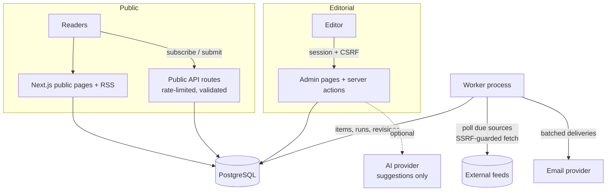
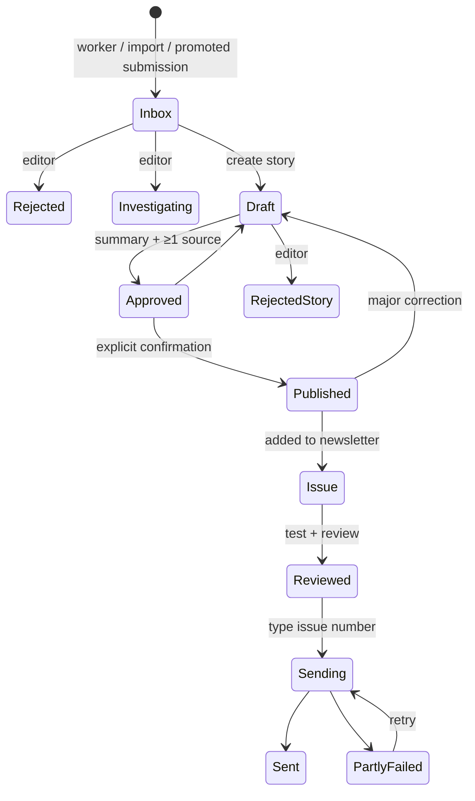

# Product plan

## MVP scope (built)

- **Public site**: home, searchable and filterable feed, story pages, newsletter archive, about and editorial standards, submit a story, community guidelines, privacy, unsubscribe, RSS, sitemap.
- **Collection**: 17 seed RSS/Atom feeds with safe fetching, deduplication, update detection and explainable relevance. CISA KEV sync is included.
- **Editorial dashboard**:
  - inbox;
  - story editor with a server-enforced workflow and audit log;
  - source manager;
  - newsletter editor with preview, test send and guarded bulk send;
  - subscribers;
  - submissions;
  - social import;
  - audit log;
  - dev mailbox.
- **Subscriptions**: double opt-in, one-click unsubscribe, rate limiting.
- **Optional parts**: AI suggestions (off by default) and social JSON import.

Out of scope for the MVP: multi-editor roles, public discussions, email webhooks, the CSAF adapter, and full-text search.

## Architecture

## Editorial workflow

## Phased roadmap

**Phase 1 — Launch (now to 1 month)**
- Configure the domain, a real email provider, SPF/DKIM/DMARC and backups.
- Run for 2–3 weeks on real feeds and tune the relevance keywords.
- Add the confirmed official feeds for Schneider Electric, Rockwell, CODESYS, ABB and CERT@VDE.

**Phase 2 — Editorial scale (1–3 months)**
- Multiple editors with roles (editor and publisher, with publish requiring a second person) and MFA.
- Email provider webhooks for delivered, bounced and complaint events, with automatic bounce handling.
- PostgreSQL full-text search, plus saved inbox filters.
- A Siemens CSAF adapter, which brings structured product and version data.

**Phase 3 — Community (3–6 months)**
- Moderated discussions on stories, with comments reviewed before they appear.
- Expert interviews and a short monthly "asset owner's corner".
- Reader polls inside the newsletter (aggregate results only).
- A referral programme (refer N colleagues to unlock an archive digest).
- Partner newsletters and cross-promotion with OT associations and CERTs.
- Community events: a quarterly online roundtable on the top advisories.

## Community growth plan

1. **Trust first**: consistent verification labels, visible sources and fast corrections.
2. **Be useful to the plant floor**: "why it matters" and attributed mitigations in every story.
3. **Reader loop**: invite replies in every issue, credit useful tips (with permission), and publish a corrections log.
4. **Distribution**: RSS for aggregators, and LinkedIn posts linking the public issue page. Ask partner communities for a mention.
5. **Measure** without invasive tracking: subscriber growth, unsubscribe rate, replies and submissions per issue.

## Operations checklist

- [ ] `APP_SECRET`, `APP_BASE_URL` and email variables set in production. `.env` is not committed.
- [ ] `npm run db:deploy` on each release. Daily `pg_dump`, with a restore tested once.
- [ ] Exactly one worker running. Alert if the last ingestion run is older than 2 hours.
- [ ] Check source health weekly and investigate failing sources.
- [ ] Before each send: test issue reviewed on desktop and mobile, no DEMO stories, links checked.
- [ ] Check bounces and complaints in the provider dashboard after each send.
- [ ] Monthly: `npm audit` and dependency updates.
- [ ] Privacy and unsubscribe copy reviewed for applicable law.

## Risks and mitigations

| Risk | Mitigation |
|---|---|
| Publishing wrong facts | Server-enforced workflow, verification labels with rules, explicit publish confirmation, corrections policy |
| AI hallucination | AI off by default; suggestions never auto-saved; prompt forbids invention and requires citations |
| Prompt injection via feeds or social posts | Feed text stored as plain text, never executed; AI input delimited and labelled untrusted |
| SSRF through admin-added sources | IP allowlisting of public addresses, DNS pinning, redirect re-validation, port restrictions |
| Feeds change or block access | Failures recorded with cause; backoff; registry documents status; no guessed URLs |
| Accidental or duplicate newsletter send | Review step, typed confirmation, atomic state change, unique delivery rows |
| Deliverability and legal issues | Double opt-in, consent versioning, one-click unsubscribe, documented DNS setup and legal review |
| Inbox overload | Relevance sorting, archived backlog, duplicate grouping |
| Sensitive OT details from submissions | Private moderation queue and community guidelines |
